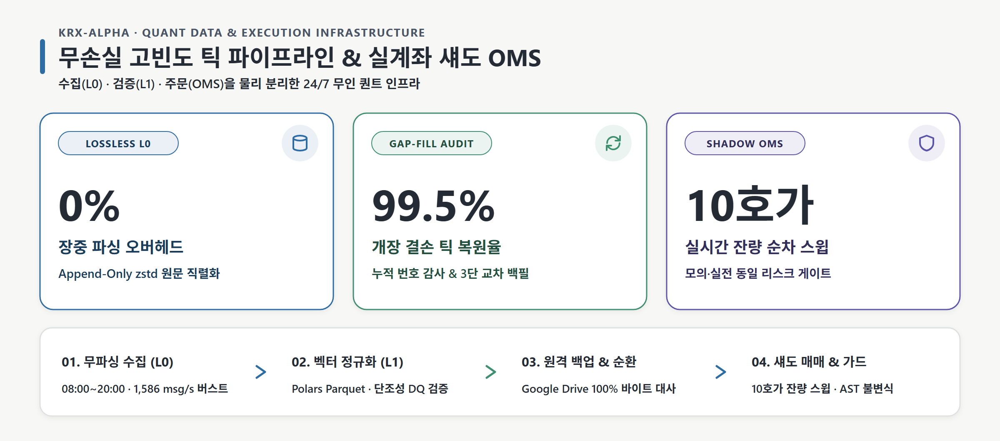
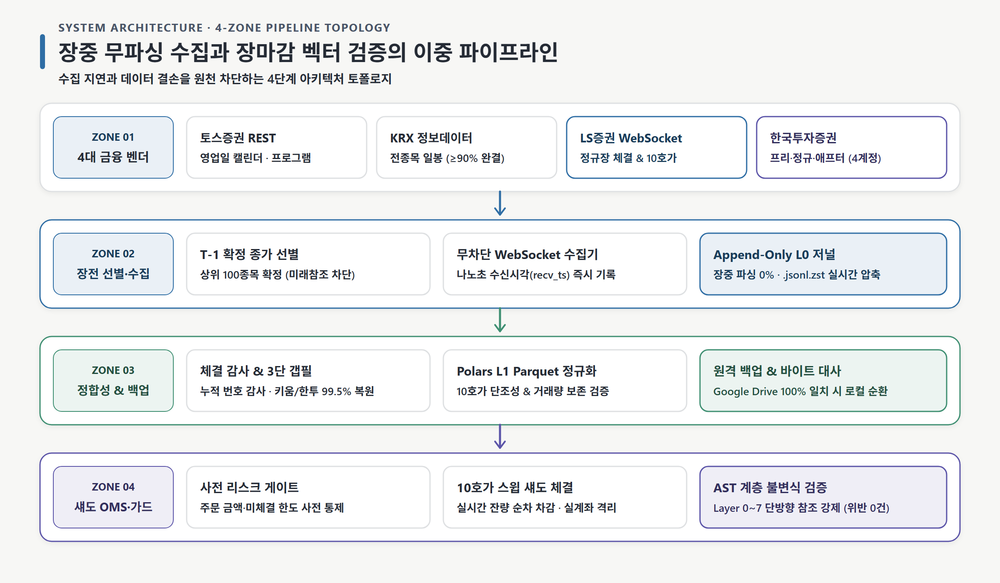
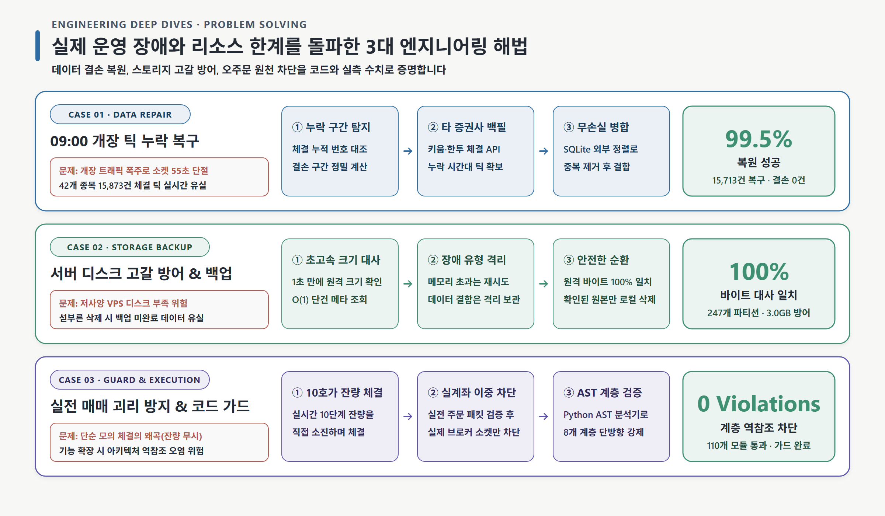

<div align="center">

# KRX-Alpha

**무손실 고빈도 틱(체결·10호가) 수집 파이프라인 & 실계좌 섀도(Shadow) OMS 엔진**

저사양 클라우드 VPS에서 한국 주식시장(프리마켓·정규장·애프터마켓) 스트림을 무손실 수집·정규화·백업하고,<br/>
실계좌 주문 직전 단계까지 동일 리스크 게이트 위에서 검증하는 **24/7 무인 퀀트 인프라**입니다.

[](./pyproject.toml) [](./src/storage/normalization.py) [](./src/storage/retention.py) [](./src/realtime/streamer.py) [](./tests/architecture/test_layering.py) [](./tests/)

</div>

<br/>

<picture>
  <source media="(prefers-color-scheme: dark)" srcset="./docs/assets/hero-overview.dark.svg">
  <source media="(prefers-color-scheme: light)" srcset="./docs/assets/hero-overview.light.svg">
  
</picture>

<br/>

## 1. 핵심 엔지니어링 보장 지표

수집 경로(L0)와 검증·연산 경로(L1/L2), 주문 집행(OMS)을 물리적으로 분리하여 **장중 트래픽 버스트 지연**, **소켓 단절 틱 누락**, **VPS 디스크 고갈**, **실전 전환 오주문**을 원천 차단합니다.

| 핵심 엔지니어링 지표 | 보장 기준 및 실측 수치 | 아키텍처 메커니즘 & 주요 모듈 |
| :--- | :---: | :--- |
| **장중 틱 데이터 손실률** | **0.00%** (`파싱 0%`) | 무파싱 Append-Only zstd 적재 · [`streamer.py`](./src/realtime/streamer.py) |
| **개장 결손 틱 복원율** | **99.5%** (`15,713건`) | 체결 시퀀스 감사 & 3단 교차 백필 · [`l0_repair_merge.py`](./src/storage/l0_repair_merge.py) |
| **스토리지 자율 순환** | **100% 일치** (`3.0 GB`) | O(1) 원격 바이트 대사 후 안전 삭제 · [`retention.py`](./src/storage/retention.py) |
| **실계좌 주문 누출 방어** | **0건** (`물리 격리`) | 실시간 10호가 잔량 순차 스윕 · [`gateways.py`](./src/execution/gateways.py) |
| **운영 안전 클럭 게이트** | **≤ 2.0s** (`Fail-Closed`) | 5-샘플 NTP 실측 게이트 & 배포 동결 · [`clock.py`](./src/realtime/clock.py) |
| **아키텍처 계층 불변식** | **0건 위반** (`3,041 Tests`) | AST 기반 Layer 0~7 단방향 참조 강제 · [`test_layering.py`](./tests/architecture/test_layering.py) |

<br/>

---

## 2. 시스템 아키텍처 & 24/7 파이프라인

단일 데몬([`daemon.py`](./src/orchestration/daemon.py))이 KST 기준 하루 4단계 생명주기를 조율하며, 모든 경계에서 **Fail-Closed** 검증을 수행합니다.

<picture>
  <source media="(prefers-color-scheme: dark)" srcset="./docs/assets/system-architecture.dark.svg">
  <source media="(prefers-color-scheme: light)" srcset="./docs/assets/system-architecture.light.svg">
  
</picture>

- **ZONE 01 · 외부 벤더 연동:** 토스증권(캘린더·프로그램), KRX(전종목 일봉 완결성 ≥90%), LS증권(정규장 체결·10호가), 한국투자증권(프리·정규·애프터마켓 4계정 샤딩 총 80종목) API를 통합합니다.
- **ZONE 02 · 장전 선별 & 무파싱 수집 (`08:00~20:00`):** 전일(T-1) 확정 종가만으로 상위 100종목(LS 200쌍 구독 예산)을 확정해 미래 참조(Look-Ahead)를 차단하고, 장중에는 스키마 파싱 없이 나노초 수신 시각(`recv_ts`)만 붙여 L0 `.jsonl.zst`에 즉시 기록합니다.
- **ZONE 03 · EOD 정합성 & 백업 (`20:00~05:30`):** 20:00 `SIGTERM` 안전 종료 후, 시퀀스 감사·갭필 → Polars 멀티 벤더 DQ 검증(10호가 단조성·거래량 보존) → L1 Parquet 승격 → Google Drive 바이트 대사 후 로컬 원본을 순환 삭제합니다.
- **ZONE 04 · 섀도 OMS & 정적 가드:** 단일 OMS 위에서 Paper(10호가 잔량 스윕)와 Live(실계좌)를 동일 리스크 게이트로 구동하며, CI에서 AST 정적 테스트로 아키텍처 침식을 차단합니다.

<br/>

---

## 3. 핵심 문제 해결 사례 (Engineering Deep Dives)

실제 서버 운영 환경에서 맞닥뜨린 **데이터 유실**, **디스크 용량 한계**, **모의 매매와 실전의 괴리**를 해결한 3가지 핵심 설계 판단입니다.

<picture>
  <source media="(prefers-color-scheme: dark)" srcset="./docs/assets/engineering-deep-dives.dark.svg">
  <source media="(prefers-color-scheme: light)" srcset="./docs/assets/engineering-deep-dives.light.svg">
  
</picture>

### Case 01. 개장 직후 트래픽 폭주로 인한 체결 틱 누락 복구
- **문제 상황:** 2026-10-20 09:00 개장 직후, 증권사 서버의 트래픽 폭주로 웹소켓 연결이 55초간 단절되어 42개 종목에서 **15,873건의 체결 데이터가 누락**됨 (수집 프로세스는 초당 1,586건 처리 성능 유지).
- **해결 방법:**
  1. **누락 구간 자동 탐지:** 체결 틱에 부여된 고유 시퀀스 번호(체결 카운터)를 대조하여 빈틈(Gap)이 발생한 시간대와 종목을 전수 산출 ([`l0_audit.py`](./src/storage/l0_audit.py)).
  2. **타 증권사 교차 백필:** 웹소켓이 끊긴 증권사 대신, 보조 증권사(키움증권·한국투자증권)의 체결 틱 조회 API를 호출하여 누락 시간대의 데이터를 백필 ([`l0_gapfill.py`](./src/storage/l0_gapfill.py)).
  3. **밀리초 단위 무손실 병합:** SQLite 외부 정렬을 거쳐 원본 데이터와 백필 데이터의 중복을 제거하고 빈 슬롯을 오차 없이 결합 ([`l0_repair_merge.py`](./src/storage/l0_repair_merge.py)).
- **결과:** 유실 구간 15,873건 중 **99.5%(15,713건)를 완벽 복원**하였으며, 이후 모든 정규 거래일 최종 결손 0건 달성 ([VPS 운영 점검표](./docs/vps-checklist.md)).

### Case 02. 저사양 서버의 디스크 고갈 방어와 안전한 백업 순환
- **문제 상황:** 클라우드 VPS의 저장 공간 한계로 원본 데이터를 주기적으로 지워야 하지만, 단순 보존 기한(TTL) 방식으로 지우면 네트워크 오류로 클라우드 백업이 덜 된 중요 금융 데이터가 영구 유실될 위험이 있음. 반면 전체 백업 목록을 매번 전수 검색하면 수십 분이 걸려 일일 마감 시간을 넘김.
- **해결 방법:**
  1. **초고속 메타 대사 ($O(1)$):** 전체 목록을 뒤지지 않고, 날짜별 접두사 단건 조회(`rclone lsjson`)로 원격 저장소(Google Drive)의 파일 크기(Byte)만 1초 만에 확인 ([`remote.py`](./src/storage/remote.py)).
  2. **장애 원인별 격리:** 메모리 초과(OOM)로 인한 변환 실패는 자동 재시도하고, 데이터 규격 오류는 격리 폴더로 분리하여 파이프라인 중단을 방지 ([`normalization.py`](./src/storage/normalization.py)).
  3. **검증 후 삭제(Offload-before-Delete):** "원격 백업 파일 크기가 로컬과 100% 일치"하고 복구 작업이 끝났음이 검증된 파일만 안전하게 로컬에서 삭제 ([`retention.py`](./src/storage/retention.py)).
- **결과:** **247개 파티션 바이트 일치 100%** 검증 및 서버 디스크 여유 공간 최소 **3.0 GB 방어선**을 무인으로 유지.

### Case 03. 모의 매매 왜곡 방지(10호가 체결)와 아키텍처 보호
- **문제 상황:** 모의 매매(Paper Trading) 시 "주문 즉시 현재가에 전량 체결된다"고 단순 가정하면, 실전 전환 시 호가창 잔량 부족으로 인한 체결 불발이나 슬리피지(체결 오차)를 검증할 수 없음. 또한 코드가 커질수록 모듈 간 엉킴(순환 참조)이 발생하기 쉬움.
- **해결 방법:**
  1. **10호가 잔량 순차 체결(Sweep):** 가상 주문이라도 실시간 10단계 호가창의 실제 잔량을 직접 깎아내며 체결가와 수량을 현실적으로 산출 ([`gateways.py`](./src/execution/gateways.py)).
  2. **실계좌 이중 차단 섀도 OMS:** 실제 증권사로 나갈 주문 전문(HTTP TR)을 똑같이 생성·검증하되, 실전 모드 명시(`LIVE_ARMED=true`)가 없으면 실제 소켓 송출만 물리적으로 차단하여 금융 사고를 원천 방지 ([`oms.py`](./src/execution/oms.py)).
  3. **AST 문법 분석 기반 아키텍처 가드:** Python AST를 파싱하여 8개 계층(Layer 0~7)의 단방향 참조 규칙과 환경변수 직접 접근 금지를 CI에서 정적으로 자동 검증 ([`test_layering.py`](./tests/architecture/test_layering.py)).
- **결과:** **110개 모듈 아키텍처 위반 0건** 유지 및 평일 장중 자동 배포 차단([`deploy_gate.py`](./src/orchestration/deploy_gate.py))으로 무인 수집의 안정성 보장.

<br/>

---

## 4. 기술 스택 & 8-Layer 구조

| 분류 | 기술 스택 | 적용 역할 |
| :--- | :--- | :--- |
| **Runtime & Stream** | **Python 3.11**, `asyncio`, `aiohttp`, **zstandard** | 다중 웹소켓 비동기 수집 및 실시간 `.jsonl.zst` 스트리밍 압축 |
| **Data & Storage** | **Polars**, **PyArrow**, Parquet, **SQLite3**, **rclone** | 멀티스레드 벡터 DQ 검증, L1 Parquet 정규화, 외부 정렬 병합, 원격 바이트 대사 |
| **Quality & Ops** | **Pydantic v2**, **Pytest**, **Ruff**, **Mypy**, **Docker Compose** | AST 계층 불변식 가드, 3,041개 테스트, `SIGTERM` 안전 종료 및 장중 배포 동결 |

```text
src/
├── core/          # [Layer 0] 시간/세션 불변식, KRX 호가단위, 예외 계층, 중앙 설정(config/paths)
├── infra/         # [Layer 1] 6-카테고리 로거, 텔레그램 알림, OAuth 토큰 매니저, HTTP 클라이언트
├── collectors/    # [Layer 2] 토스(캘린더/프로그램), KRX(일봉), 키움(틱 테이프), KIS/LS REST 수집기
├── realtime/      # [Layer 3] NTP 클럭 게이트(clock.py), LS·KIS 무차단 WebSocket 스트리머(streamer.py)
├── storage/       # [Layer 3] L0 감사(l0_audit.py), 3단 갭필(l0_repair_merge.py), L1 정규화, 보존/백업(retention.py)
├── universe/      # [Layer 4] T-1 모멘텀·유동성 기반 2-Tier 종목 선별 및 구독 예산 할당
├── features/      # [Layer 5] L2 피처 패널 빌드, 호가 불균형(OBI)·VPIN·돌파 신호 및 알파 엔진
├── execution/     # [Layer 6] 사전 리스크 게이트, 단일 OMS, Paper(10호가 스윕)·Mock·Live 게이트웨이
├── orchestration/ # [Layer 7] 24/7 자율 데몬(daemon.py), EOD 파이프라인, 장중 배포 동결(deploy_gate.py)
└── cli/           # [Layer 7] 스트리머, 정규화, 갭필, 감사, 백테스트, 페이퍼/라이브 실행 CLI
```

<br/>

---

## 5. 빠른 시작 및 검증 (Quick Start)

```bash
# 1. 환경 구성 (Python 3.11 + uv)
uv sync --frozen && cp .env.example .env

# 2. 아키텍처 불변식(AST 계층·용어 가드) 및 전체 테스트(3,041건) 실행
uv run pytest tests/architecture/
uv run pytest

# 3. 통합 품질 게이트 (Ruff + Mypy + 변경 영향 테스트)
uv run python tools/verify.py

# 4. 주요 파이프라인 및 섀도 OMS 실행 예시
uv run krx-gapfill --date 2026-10-20    # L0 시퀀스 감사 및 3단 교차 갭필
uv run krx-normalize --date 2026-10-20  # L0 -> L1 Parquet 벡터 정규화 & DQ 검증
uv run krx-exec --mode paper            # 실계좌 섀도(10호가 스윕) 모드 실행
docker compose up -d krx-daemon         # 24/7 무인 데몬 컨테이너 기동
```

- **상세 레퍼런스:** [브로커 API 마스터 명세](./docs/architecture/brokers/api_master.md) · [VPS 운영 점검표](./docs/vps-checklist.md)
