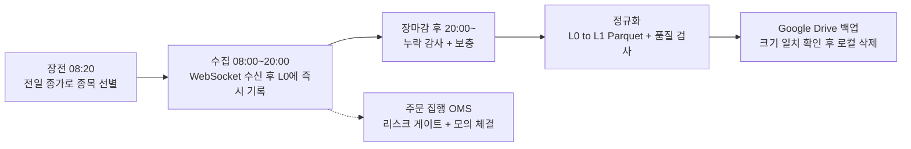

# KRX-Alpha

**한국 주식 단기투자 연구를 위해, 호가·체결 틱 데이터를 빠짐없이 모으고 검증하는 퀀트 데이터 파이프라인**

[](./pyproject.toml) [](./src/storage/normalization.py) [](./src/realtime/streamer.py) [](./.github/workflows/deploy.yml)

> [!NOTE]
> 전략(알파) 연구 단계는 시작 전이며, 이 README는 구현된 수집·검증·집행 부분을 설명합니다. 실계좌 수익 같은 성과 수치는 없습니다.

## 🧭 개요

단기투자 전략의 백테스트는 데이터에 구멍이 있거나 미래 정보가 섞이면 쉽게 틀어집니다. 그런데 한국 증권사 실시간 API는 접속이 끊기거나 지연되면 그 구간의 체결을 다시 보내 주지 않습니다. 그래서 다음 세 가지를 목표로 했습니다.

- **빠짐없이 모으기:** 프리마켓, 정규장, 애프터마켓의 체결·10호가를 매 영업일 자동으로 수집합니다.
- **빠진 곳 찾아 메우기:** 틱마다 붙은 순번(체결 카운터)으로 누락을 찾아 다른 증권사 API로 보충합니다.
- **전략 검증 환경 먼저 만들기:** 모의 주문이 실제 호가 잔량을 기준으로 체결되게 하고, 실계좌 주문은 명시적으로 허용하지 않으면 나가지 않게 막습니다.

저사양 클라우드 서버(Oracle ARM VPS, 메모리 1~3 GiB 컨테이너)에서 사람 없이 매일 돌아가도록 설계했습니다.

## 🏗️ 시스템 구성

하나의 데몬([`daemon.py`](./src/orchestration/daemon.py))이 한국 시간 기준 하루 일정을 돌립니다.



- **L0(원본):** 받은 메시지를 파싱하지 않고 수신 시각(`recv_ts`)만 붙여 `.jsonl.zst`로 이어 씁니다. 장중에 처리 부담을 줄이고 원본을 그대로 남기기 위해서입니다.
- **L1(정제):** 장마감 후 중복 제거와 품질 검사를 거쳐 Parquet으로 바꿉니다([`normalization.py`](./src/storage/normalization.py)).
- **데이터 출처:** 실시간 체결·호가는 LS증권(정규장)과 한국투자증권(프리·애프터마켓, 정규장 보조)이고, 휴장일 달력은 토스증권, 일봉은 KRX, 누락 보충용 체결 이력은 키움증권을 씁니다.
- **종목 선별:** 구독 한도가 있어 전일(T-1) 확정 데이터만으로 종목을 고릅니다. 당일 정보가 섞이는 것을 막기 위해서입니다([`policy.py`](./src/universe/policy.py)).

## 🔧 핵심 설계 결정

각 결정을 **문제 → 분석(대안 비교) → 선택 → 결과** 순서로 정리했습니다.

### 🧩 1. 장중에는 파싱하지 않고 원본만 기록

- **문제:** 개장 직후에는 초당 메시지가 몰립니다. 수신 중에 파싱·검증까지 하면 처리가 밀려 메시지를 놓칠 수 있습니다.
- **분석:** 수신하며 바로 정제하면 구현은 단순하지만, 파싱 오류가 곧 데이터 손실이 됩니다. 원본을 먼저 남기면 나중에 규칙을 고쳐도 다시 계산할 수 있습니다.
- **선택:** 수신 경로는 "받은 그대로 압축해 이어 쓰기"만 하고, 해석은 장마감 후 별도 단계에서 합니다.
- ✅ **결과:** 수신 경로는 압축 후 이어 쓰기만 수행하고, 파싱·중복 제거·품질 검사는 정규화 단계로 분리되어 있습니다.

### 🩹 2. 끊긴 구간의 체결을 순번으로 찾아 다른 증권사로 보충

- **문제:** 개장 직후처럼 메시지가 몰릴 때 수신 지연이 커지다 연결이 끊기면, 그 구간의 체결은 증권사가 다시 보내 주지 않아 영구히 빠집니다.
- **분석:** 같은 증권사에 다시 요청해도 이미 지나간 체결은 받을 수 없습니다. 다른 증권사의 체결 이력 API를 쓰되, 어느 시간대·종목이 비었는지 먼저 정확히 알아야 합니다.
- **선택:** 세 단계로 나눴습니다. (1) 체결 순번의 빈틈을 종목별로 계산합니다([`l0_audit.py`](./src/storage/l0_audit.py)). (2) 키움 체결 이력과 한국투자증권 API로 빈 구간을 채웁니다([`l0_gapfill.py`](./src/storage/l0_gapfill.py)). (3) 원본과 보충분을 SQLite 외부 정렬로 합치며 중복을 제거합니다([`l0_repair_merge.py`](./src/storage/l0_repair_merge.py)). 보충분은 별도 파일에 출처(`vendor`, `provenance`)를 붙여 저장하고 L0 원본은 건드리지 않습니다.
- ✅ **결과:** 감사 → 보충 → 병합이 각각 독립된 CLI 단계로 나뉘어 있고, 보충분은 출처가 표시된 별도 파일로만 쌓입니다.

### 💾 3. 작은 디스크에서 안전하게 비우기

- **문제:** 틱 원본은 하루에도 크게 쌓이는데 VPS 디스크는 작습니다. 보존 기간만 보고 지우면, 업로드가 덜 된 파일까지 지울 수 있습니다.
- **분석:** 원격 전체 목록을 매번 훑는 방법은 느립니다. 날짜별 접두사로 파일 하나씩 크기를 조회하면 빠르게 대조할 수 있습니다.
- **선택:** 원격(Google Drive)에 같은 크기의 파일이 있고 정규화가 끝난 파티션만 로컬에서 지웁니다([`remote.py`](./src/storage/remote.py), [`retention.py`](./src/storage/retention.py)). 여유 공간이 3 GB 아래로 내려가면 수집을 멈추는 장치도 둡니다(설정 `min_free_disk_gb`).
- ✅ **결과:** 업로드 확인이 안 된 파티션은 보존 기간이 지나도 삭제 대상에서 제외됩니다.

### ⏱️ 4. 시계가 틀리면 멈추는 구조

- **문제:** 틱 분석은 시각이 핵심인데 서버 시계가 어긋나면 수신 시각이 믿을 수 없게 됩니다.
- **선택:** 세션 시작 시 NTP 서버에 5번 물어 중앙값을 구하고, 오차가 2.0초를 넘으면 `ClockUnsyncedError`로 수집을 시작하지 않습니다([`clock.py`](./src/realtime/clock.py), 설정 상한 `max_clock_offset_ns`).
- ✅ **결과:** 시계가 어긋난 상태로는 데이터가 쌓이지 않아, 잘못된 수신 시각이 분석에 섞이지 않습니다.

### 🧪 5. 모의 주문을 실제 호가 잔량으로 체결

- **문제:** 모의 매매에서 "주문하면 현재가에 전량 체결"로 가정하면 실전에서 호가 잔량이 부족한 경우와 슬리피지(체결가 차이)를 확인할 수 없습니다.
- **분석:** 현재가 즉시 체결은 단순하지만 낙관적입니다. 호가창을 직접 소진시키면 더 현실에 가깝습니다.
- **선택:** 10단계 호가를 위에서부터 소진하며 체결가와 수량을 계산하고, 지정가는 한도를 넘으면 멈춥니다([`gateways.py`](./src/execution/gateways.py)의 `simulate_paper_fills`). 주문은 하나의 OMS를 거쳐 사전 리스크 게이트(주문 금액·분당 주문 수·일 손실 한도·종목 화이트리스트)를 통과해야 합니다([`risk.py`](./src/execution/risk.py), [`oms.py`](./src/execution/oms.py)). 실계좌 모드는 `KRX_ALPHA_EXEC_LIVE_ARMED=true`가 없으면 설정 단계에서 오류가 납니다([`config.py`](./src/core/config.py)). 기본값은 모의(paper)입니다.
- ✅ **결과:** 모의/모의투자/실계좌 세 모드가 같은 OMS를 쓰고, 실계좌만 명시적 허용이 필요합니다. 체결 현실성을 실제 체결과 비교한 검증은 아직 하지 않았습니다.

### 🧱 6. 모듈 구조를 테스트로 강제

- **문제:** 코드가 커질수록 모듈끼리 서로 불러 순환 참조가 생기기 쉽고, 수집 코드가 주문 코드에 의존하는 식의 역방향 연결이 생길 수 있습니다.
- **선택:** 모든 모듈에 계층 번호(0~7)를 부여하고, 파이썬 AST로 import를 분석해 "위 계층 참조 금지, 순환 금지"를 테스트로 확인합니다. 새 모듈은 계층표에 등록하지 않으면 테스트가 실패합니다([`test_layering.py`](./tests/architecture/test_layering.py), [`layers.py`](./tests/architecture/layers.py)).
- ✅ **결과:** GitHub Actions가 push마다 전체 테스트를 실행합니다. 평일 장중(08:10~22:00)에는 컨테이너 재기동을 22:00으로 미루는 배포 게이트도 있습니다([`deploy_gate.py`](./src/orchestration/deploy_gate.py)).

## 📊 규모

| 항목 | 내용 | 측정 기준 |
| :--- | :--- | :--- |
| 코드 규모 | `src` 134개 파일, 약 3만 줄 | 저장소 파일 집계 |
| 테스트 | 테스트 함수 약 2,860개 | `def test_` 개수(파라미터 확장 전) |
| 개발 기간 | 2026-09-08 ~, 커밋 315개 | git 이력 |

## ⚠️ 한계

- **전략(알파) 단계 없음:** 현재는 데이터 수집·검증·집행 기반이며, 신호 생성과 백테스트 엔진은 이 저장소에 없습니다. 실계좌 성과도 없습니다.
- **틱 손실 0은 아닙니다:** 증권사가 당일 체결만 제공하는 등 보충 API로 복구할 수 없는 구간이 있을 수 있습니다.
- **모의 체결 현실성 미검증:** 10호가 소진 방식이 실제 체결과 얼마나 맞는지는 비교하지 않았습니다. 호가 소진 후의 시장 충격은 반영하지 않습니다.
- **재현 환경 제약:** 증권사 API 키와 서버 환경이 필요해, 수집 파이프라인 전체를 다른 곳에서 바로 돌릴 수는 없습니다. 테스트는 키 없이 실행됩니다.

## 🧱 기술 스택

| 구분 | 사용 기술 |
| :--- | :--- |
| 언어/런타임 | Python 3.11, asyncio, aiohttp, WebSocket |
| 데이터 | Polars, PyArrow(Parquet), NumPy, SQLite, zstandard |
| 설정/검증 | Pydantic v2, pydantic-settings, ntplib |
| 품질 | pytest, Ruff, Mypy, 계층 검사(AST) |
| 배포/운영 | Docker Compose, GitHub Actions(GHCR 이미지), systemd 타이머, rclone(Google Drive) |

## 📂 프로젝트 구조

```text
src/
├── core/           # 설정, 거래 달력, 오류, 경로, 로깅 (최하위 계층)
├── marketdata/     # 일봉, 분봉, 스냅샷, 토스/키움 수집
├── realtime/       # WebSocket 스트리머, 벤더 어댑터, NTP 클럭 게이트
├── universe/       # 전일 기준 종목 선별, 구독 예산
├── storage/        # L0 감사/보충/병합, L1 정규화, 원격 대사, 보존
├── execution/      # 리스크 게이트, OMS, 모의/실계좌 게이트웨이
├── brokers/        # 한국투자증권 API 클라이언트
├── orchestration/  # 24시간 데몬, EOD 작업, 배포 게이트
└── cli/            # 수집·보충·백필·주문 명령
tests/              # 단위 테스트와 계층 검사(tests/architecture)
deploy/host/        # 호스트 백업, 이미지 정리 등 systemd 유닛
docs/               # 브로커 API 명세
```

## 🚀 시작하기

증권사 API 키가 필요한 수집 기능은 로컬에서 바로 실행할 수 없고, 테스트와 품질 검사는 키 없이 실행됩니다. 키와 계좌 정보는 환경변수 파일로 분리하며 저장소에는 올리지 않습니다.

```bash
uv sync --frozen                         # Python 3.11, 의존성 설치

uv run pytest tests/architecture/        # 계층·순환 참조 검사
uv run pytest                            # 전체 테스트
uv run python tools/verify.py            # Ruff + Mypy + 변경 영향 테스트

# 하위 명령은 키가 설정된 환경에서 실행합니다
uv run python -m src.cli.main --help
uv run python -m src.cli.main gapfill-ticks --help
docker compose up -d krx-collector       # 24시간 수집 데몬
```

## 🤖 개발 과정에서의 AI 활용

AI 코딩 도구를 주로 코드를 쓰는 데 사용했고, 아이디어를 다듬거나 시장 구조 같은 도메인을 공부할 때도 썼습니다. 수치와 동작은 직접 확인했습니다.

| AI에 맡긴 일 | 직접 한 일 |
| :--- | :--- |
| 코드 작성 | 수집·집행 구조와 설계 방향 결정 |
| 아이디어 정리, 도메인 학습 보조 | 결과 수치와 동작 확인 |

## 📚 참고

- [브로커 API 명세](./docs/architecture/brokers/api_master.md)
